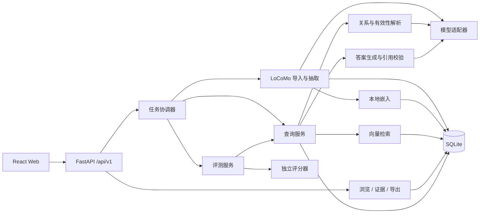

# 系统设计说明

## 智能体动态记忆管理 · M4

| 项目 | 内容 |
|---|---|
| 团队 | 第六组 · SRE小组 |
| 版本 / 日期 | v0.1 / 2026-10-20 |
| 状态 | 开发设计基线；本文描述计划实现，尚无运行或测试通过结论 |
| 需求依据 | [M3 SRS v0.1](MILESTONE3/PROJECT-MILESTONE3-第六组-SRE小组.md) |
| 当前基础 | 已取得 `data/raw/locomo10.json`；课程子集及动态标注待确认 |

## 1. 技术决策

采用前后端分离、模块化单体后端、本地单用户部署。算法与评测共用 Python 服务层，前端只负责交互和展示。M4 优先交付必做链路。

| 层 | 选定技术 | 理由与边界 |
|---|---|---|
| 后端运行时 | Python 3.11 | 统一数据处理、模型调用、检索及评测环境 |
| Web API | FastAPI + Uvicorn、Pydantic 2 | 类型校验、响应模型和 OpenAPI 文档，便于前后端对接 |
| 持久化 | SQLite + SQLAlchemy 2 + Alembic | 本地单文件数据、关系约束、事务和版本迁移；单 worker、短写事务 |
| 前端 | React + TypeScript + Vite | 组件化实现记忆浏览、问答与解析详情，接口类型明确 |
| UI | Ant Design、原生 Fetch | 直接使用表格、表单、抽屉、标签和时间线；不额外引入全局状态库 |
| 嵌入 | Sentence Transformers，`sentence-transformers/all-MiniLM-L6-v2` | LoCoMo 为英文，使用本地英文句向量；冻结模型 revision 并缓存权重 |
| 检索 | NumPy float32 归一化向量点积 | 全量精确余弦搜索，先按对话与时间过滤；当前规模无需独立向量数据库 |
| 大模型访问 | HTTPX + 模型适配器 | 抽取、关系与回答共用接口；服务地址、凭据及模型 ID 由环境配置提供 |
| 任务 | SQLite 任务表 + 进程内单任务执行器 | 构建、问答和批量评测异步反馈；M4 不引入 Redis/Celery |
| 测试 | pytest + HTTPX、Vitest + Testing Library、Playwright | 分别验证规则/API、页面状态与完整演示链路 |
| 工具 | uv、npm；Ruff、ESLint、TypeScript 检查 | Python/前端依赖分别锁定，保持团队环境一致 |

前端工具链选 Node.js 22.12+（22 系列）作为团队基线。具体补丁版本和依赖版本在首次安装成功后写入锁文件，不在设计阶段宣称已验证兼容。SQLite/NumPy 是否满足响应目标须按 SRS 实测。

模型服务采用可配置的聊天消息 HTTP 协议适配器，结构化 JSON 由 Pydantic 校验；不要求供应商一定支持原生结构化输出。默认不指定商业模型 ID，避免把不可用或未取得凭据的型号写成已选定资源；真实模型和预算为唯一仍需资源确认的模型决策。正式运行配置必须有非空 model ID，并记录服务商、参数及提示词版本。测试使用固定响应适配器，不将模拟结果计为模型质量。

不采用微服务、图数据库、独立向量服务或复杂 Agent 框架：当前数据量与必做需求可由一个 Python 应用承载。后续 Bonus 通过检索器与解析器接口扩展。

## 2. 总体架构



数据边界：导入器只向构建服务传递 `conversation`；原始 JSON 其余标注交由独立评分器读取。QA 的 question 可进入查询服务，answer/evidence/category 与 event_summary、observation、session_summary 不进入抽取、索引、关系或生成提示词。

## 3. 模块及职责

| 模块 | 输入 / 输出 | 主要职责 | SRS |
|---|---|---|---|
| ingestion | 原始 JSON → 标准对话记录 | 字段校验、按数字排序 session、解析时间、重复导入检查 | FR-01 |
| extraction | 对话窗口 → Memory | 带轮次抽取、结构校验、来源合法性校验、去重 | FR-02/03 |
| repository | 标准对象 ↔ SQLite | 事务、构建版本隔离、分页、来源和关系约束 | FR-01–06 |
| embedding / retrieval | Memory/问题 → 候选与分数 | 固定嵌入模型、筛选、精确 top K | FR-08 |
| temporal | 问题/as_of → 查询范围 | 默认截止、历史过滤、无法确定时间时澄清 | FR-07/10 |
| resolution | 问题+候选 → 关系/有效性 | 模型判定、方向与引用检查、确定性状态归约 | FR-09/10 |
| answering | 有效/冲突记忆 → 答案 | 受证据约束生成、引用校验、证据不足或未决状态 | FR-11 |
| jobs / API | 请求 → 任务/结果 | 参数校验、串行任务、进度、错误与超时 | FR-03/07/12 |
| evaluation | 问题+配置 → 预测，再评分 | 三方法公平运行、逐题记录、失败统计、指标 | FR-13 |
| frontend | API 数据 → 页面 | 浏览、原文抽屉、查询、关系与状态展示 | FR-05/06/12 |

## 4. 数据设计

### 4.1 已下载数据

当前文件含 10 项，sample_id 为 `conv-26`、`conv-30`、`conv-41`、`conv-42`、`conv-43`、`conv-44`、`conv-47`、`conv-48`、`conv-49`、`conv-50`。

2026-10-20 本地文件 SHA-256：

`79fa87e90f04081343b8c8debecb80a9a6842b76a7aa537dc9fdf651ea698ff4`

该值用于核查本次下载，不代表上游分支今后不会变化。正式实验使用文件摘要及上游 commit（如可取得）标记版本。

官方 `sample_id` 映射 conversation_id，`dia_id` 映射 turn_id；`session_<n>` 按 n 数值排序，`session_<n>_date_time` 保留原始字符串。会话时间如 `1:56 pm on 8 May, 2023` 按固定英文格式解析；时区未知时保留本地时间语义，不默认添加 UTC。

split 允许 `unassigned/dev/test/extension`。课程名单未确认前导入为 unassigned，禁止生成“正式 test 结果”；开发样例选择须单独记录，不能隐式指定课程划分。

### 4.2 主要表

| 表 | 主键 / 关键列及约束 |
|---|---|
| datasets | dataset_id、sha256 唯一、source_url、upstream_commit 可空、imported_at |
| conversations | `(dataset_id, conversation_id)`、split、speaker_a/b |
| sessions | `(dataset_id, conversation_id, session_id)`、sequence、raw_time、parsed_time |
| turns | `(dataset_id, conversation_id, session_id, turn_id)`、sequence、speaker、text、可选图像元数据 |
| builds | build_id、dataset_id、conversation_id、config_hash、状态、active 标记 |
| memories | `(build_id, memory_id)`、content、entity、attribute、value、session_time、time_expression、event_time、time_precision、time_basis、record_status |
| memory_sources | `(build_id, memory_id, session_id, turn_id)`，外键引用同数据版本和对话中的原始轮次 |
| embeddings | `(build_id, memory_id, embedding_revision)`、dimension、归一化 float32 BLOB |
| tasks | task_id、kind、status、progress、counts、error、heartbeat、config_json |
| queries | query_id、task_id、build_id、question、as_of、resolved_cutoff、status、result_json、config_json |
| relations | `(query_id, relation_id)`、from_id、to_id、type、reason、evidence_ids_json |
| evaluations | run_id、split_manifest_hash、config_json、预测路径、评分路径、状态 |

有效性保存在 query result，禁止在 memories 上写全局 active/inactive 代替查询级解析。所有 ID 关联须限定 build 和 query。常用索引：对话/会话时间、Memory build/entity、任务状态；向量行由固定 build 加载到内存并保留 Memory ID 对照。

每次构建有独立 build_id；只有全部必需批次完成、来源和向量校验通过后，才原子切换该对话的 active build。失败构建保留供诊断但不自动用于问答。查询固定 build 快照，重建不影响已保存结果。导出含 schema_version、build 配置、数据版本和来源清单，遵循 SRS 第 3 节。

## 5. 核心流程与算法

### 5.1 导入和记忆构建

1. 校验顶层列表、sample_id、会话/轮次 ID；同一文件摘要再次导入返回已有数据版本。
2. 保存原文，抽取输入仅由明确白名单字段组装。
3. 按会话切窗，初始每窗最多 20 轮、重叠 2 轮，并受模型 token 预算限制；超长单轮不静默截断，记录失败并调整窗口。
4. 提示模型输出原子事实、实体/属性/值、时间原文及 sources；不得输出不可验证的来源 ID。
5. Pydantic 校验字段，逐一检查来源存在、属于当前对话且在本窗口。内容为空、来源捏造或时间推导无依据的项记录为失败/待核查。
6. 对同构建中“规范化 content + 排序 sources”做确定性去重；ID 为对话前缀加内容/来源摘要。重试以窗口 ID 和 config_hash 幂等写入。
7. 本地嵌入 content，归一化并存储模型 revision 和 dimension；完成后激活 build。

跨窗口代词解析质量属于测试重点；可加入说话人和少量前文作为上下文，但来源只能引用实际输入轮次。M4 不读取现成 observation/summary 替代自动抽取。

### 5.2 时间与检索

- 请求显式 as_of 优先；若问题中的时间与其矛盾，返回 clarification_required，不静默选择。
- 无显式 as_of 时，时间解析器识别明确历史日期/区间并形成截止条件；无法可靠解析的历史表达请求澄清。普通当前问题使用对话末端时间。
- 先依据来源会话时间过滤，再计算归一化问题向量与 Memory 向量的点积并排序；多来源记忆须全部来源不晚于截止。时间缺失且无法证明可用的记忆不纳入历史截止查询，返回警告。
- 来源可用不等同事件有效：事件时间与问题的进一步匹配交给解析层。来源时间晚于截止的追述不用于历史截止问题，遵循 SRS 的保守防泄漏约定。
- 默认 K=10，允许 1–50；同分按 memory_id 排序。返回 raw cosine_score，不把分数冒充概率。
- 本方法与 Vector RAG 复用同一候选快照；M4 不额外引入混合召回或二次检索，避免对照变量混杂。

### 5.3 关系判定与有效性

一次关系判定调用输入问题、时间、至多 K 条候选及来源，输出关系数组和每条候选的相关性/时间适用性。理由只需简短、可证据核查的结论，不要求输出模型内部思考过程。

服务端先校验端点属于候选、证据引用存在、类型合法、无自环及重复边；UPDATE/SUPERSEDE 方向为旧→新，CONFLICT/RETAIN 规范化端点顺序。候选上限控制 token 预算，不能在超预算时偷偷删去候选后宣称比较完整。

确定性归约器处理：

1. 排除无关或不满足查询时间的项。
2. 对有证据支持且时间适用的更新/替代链，当前状态使用链末端，旧节点标 historical。
3. 历史查询依据其时间范围选择适用阶段，不能直接复用当前问题的有效集合。
4. 未决冲突双方标 conflict；循环、缺失时间依据或不一致关系标 uncertain，不任意选真。
5. 无关系的兼容相关项可标 effective，无须伪造 RETAIN 边；保留全部理由用于展示。

自动规则不能保证语义判定准确，须通过受控测试及课程 gold 评测；失败不被包装成确定性正确。

### 5.4 回答

答案调用只接收有效记忆和需披露的冲突证据，不传入已判为 historical 的事实冒充当前证据。输出 answer 与 citation memory IDs，后处理校验引用范围。无有效证据时可直接返回 insufficient_evidence；影响结论的冲突返回 unresolved_conflict，同时允许回答不受冲突影响的部分。

非法引用或模型 JSON 无效，最多执行一次格式修复；仍失败返回结构化错误，不向用户显示未经校验的答案。引用存在性不能证明语义支持正确，语义支持由 AT-14 与抽样人工检查验证。

## 6. API 契约

前缀 `/api/v1`，JSON 使用 snake_case，ID 为字符串。异步任务创建返回 202；读取成功返回 200。UUID 作为 task/query ID。OpenAPI 是实现后的接口真源，变更须同步本文和前端类型。

| 方法 / 路径 | 输入 | 输出 |
|---|---|---|
| GET /health | 无 | 服务/数据库/模型配置状态，不含密钥 |
| POST /datasets/import | multipart file、可选 split_manifest | task_id |
| GET /conversations | dataset_id | 对话列表、split、轮次数、active_build |
| POST /conversations/{id}/builds | dataset_id、构建配置引用 | task_id、build_id |
| GET /tasks/{task_id} | 无 | kind、status、progress、counts、error、result_ref |
| POST /tasks/{task_id}/retry | 无 | 新 task_id、原任务关联；仅可重试失败任务 |
| GET /conversations/{id}/memories | dataset_id、可选 build_id/entity/keyword、page、page_size | items、total、page、page_size |
| GET /memories/{memory_id} | build_id | Memory、全部来源及原文 |
| GET /conversations/{id}/export | dataset_id、可选 build_id | UTF-8 JSON 下载 |
| POST /queries | 见下例 | task_id、query_id |
| GET /queries/{query_id} | 无 | 已完成结果或当前任务状态 |
| POST /evaluations | split_manifest、methods、配置引用 | task_id、run_id |
| GET /evaluations/{run_id} | 无 | 运行状态、样本数、指标、失败数及结果引用 |

详情和结果查询都由后端限定文件范围，不接受任意服务器文件路径。上传限制初定 20 MiB，page_size 默认 20、最大 100；参数不合法返回 422，对话不存在 404，未完成构建/状态冲突 409，模型调用失败在任务 error 中记录 provider_error/timeout。HTTP 错误统一包装 code、message、request_id；FastAPI 默认校验错误需统一处理。

查询请求：

```json
{
  "dataset_id": "dataset-sha256",
  "conversation_id": "conv-26",
  "question": "What is Caroline's current adoption status?",
  "as_of": null,
  "top_k": 10,
  "method": "dynamic"
}
```

method 为 dynamic/vector_rag/full_text；Web 默认 dynamic。响应结果包含 SRS QueryResult，额外包含 build_id、method、warnings、timings_ms。Memory 浏览的 record_status 与查询有效性分别展示。

## 7. 任务执行、恢复与错误

所有外部模型调用由单任务执行器串行调度，API 事件循环不执行嵌入或阻塞 I/O；工作线程使用独立数据库 session。M4 启动一个 Uvicorn worker，避免重复消费。任务按创建时间领取并用事务更新 queued→running。

状态为 queued/running/succeeded/partial_failed/failed/interrupted。任务阶段包含 validating/extracting/embedding/retrieving/resolving/answering/scoring；进度按可完成工作量计算，未知总量不显示虚假的百分比。任务完成时 result_ref 指向对应 query/build/run。

初始模型配置：连接超时 10 秒、单次请求 60 秒，最多 2 次传输尝试，仅重试 429/可恢复 5xx/连接错误，退避并尊重 Retry-After；任务总时限初定 30 分钟。格式修复最多一次且受总时限控制，服务端记录每次尝试。问答界面显示等待及阶段，不承诺在外部超时前完成。

进程重启将遗留 running 标记 interrupted，用户显式重试；构建按已提交窗口恢复，评测按 question_id+method 恢复，普通问答重试生成新记录。此方案不能提供高可用和跨进程可靠队列；本地课堂场景接受该限制。

## 8. 页面设计

| 页面 | 核心组件和交互 |
|---|---|
| 数据与构建 | 数据导入、版本/划分、对话规模、构建按钮、任务进度、失败与重试 |
| 记忆浏览 | 对话选择、实体/关键词筛选、分页表格、导出；点击打开原文证据抽屉 |
| 问答与解析 | 问题、截止时间、K；答案与引用；候选列表、关系时间线、有效/历史/冲突/不确定标签 |
| 评测结果 | 方法/划分/运行配置、三项指标、失败数、逐题对比和失败原因 |

前端通过 1 秒轮询任务状态，任务结束停止轮询，离开页面清理轮询；失败采用有限退避。使用 request/task ID 绑定结果，防止旧请求覆盖新问题。对话切换清空旧候选。未知值显示“未知”，冲突不只靠颜色区分；原文按文本渲染，不使用不可信 HTML。

## 9. 评测设计

评测读取统一配置及显式数据划分。先生成不含 gold 的逐题预测 JSONL，再由独立评分器读取答案、证据和课程关系标注评分。开发态不暴露 test 参考答案页面。

- Full Text：只用允许时间内的原始对话，超模型上下文时记录 context_overflow；M4 不静默截断成另一方法。
- Vector RAG：与 dynamic 共用抽取版本、嵌入版本、K、候选快照及生成模型，跳过关系解析。
- Dynamic：在同一候选上增加关系和有效性解析。
- 指标使用 SRS 第 8 节口径；缺失关系 gold 标 unavailable，不能用模型自身输出作真值。
- Full Text 的 Recall@K、无关系输出基线的关系准确率为 N/A；本方法额外记录关系误报数量。
- 所有方法保存 token/耗时/调用次数与失败；相同题序、配置和版本，test 冻结后不调参。

产物：`predictions.jsonl`、`metrics.json`、`errors.jsonl`、`config.json`、`manifest.json`。保存数据/划分摘要、代码 commit、模型与嵌入 revision、提示词 hash、K、时间规则、依赖锁摘要；错误题不静默剔除。

## 10. 目录与本地部署

以下为待创建的工程布局，当前不代表相关代码已存在：

```text
backend/
  app/{api,schemas,models,repositories,services,providers,prompts}/
  tests/
  migrations/
  pyproject.toml
  uv.lock
frontend/
  src/{api,types,pages,components}/
  package.json
  package-lock.json
scripts/                 # 导入、构建、评测命令入口，复用服务层
configs/                 # 非敏感参数、划分清单、实验配置
  splits.json
data/
  raw/locomo10.json
  processed/             # 导出及来源清单
  runtime/               # SQLite，忽略 Git
outputs/evaluations/     # 运行产物，选择性提交报告
.env.example             # 仅占位配置
```

本地开发：前端 5173 代理 `/api` 到后端 8000，后端只绑定 127.0.0.1；统一使用相对 API 地址。演示构建后由 FastAPI 提供 frontend/dist 静态资源与 SPA 路由回退，API 不得被静态回退覆盖；用户只需访问 8000。Docker 不是 M4 前置条件。

关键配置：DATABASE_URL、DATA_DIR、OUTPUT_DIR、LLM_BASE_URL、LLM_API_KEY、LLM_MODEL、EMBEDDING_MODEL、EMBEDDING_REVISION、REQUEST_TIMEOUT_SECONDS、MAX_ATTEMPTS、DEFAULT_TOP_K。仅公开无敏感信息的健康状态；不将密钥放入 VITE_* 变量。首次需联网下载嵌入权重；后续可离线加载缓存，模型生成仍需服务可用。

实施时锁定依赖并提供启动命令；本文不提供尚不存在工程的伪启动成功示例。不得提交数据库、真实 .env 或模型缓存。

## 11. 实施与验证顺序

| 阶段 | 产出 | 验证 |
|---|---|---|
| 1 | 工程骨架、数据标准化、来源表、API 类型 | AT-01/02/07，核对真实样例时间格式与 ID |
| 2 | 抽取、构建任务、JSON、浏览与证据 | AT-03–06，完成一段明确标记的开发样例 |
| 3 | 向量检索、关系解析、回答及页面联调 | AT-08–15，覆盖更新/替代/冲突/历史截止 |
| 4 | 三方法评测、配置产物、恢复与部署 | AT-16–19，记录失败与实测性能 |

算法/数据负责人冻结字段与提示词，后端实现服务和任务，前端按 API 契约并行开发，测试负责人用固定适配器验证流程并用真实模型单独评测。每阶段至少保留实现与修复复测两轮记录；源代码、测试结果及中期展示另行交付。

尚待资源/课程确认：课程子集、动态 gold、生成模型 ID/预算、正式指标口径和性能验收环境。技术栈与模块边界已选定；这些待确认项不阻止工程骨架、导入和接口开发。

## 12. 官方技术参考

- [FastAPI](https://fastapi.tiangolo.com/)：类型化 API、校验与交互文档。
- [Vite 入门](https://vite.dev/guide/)：前端构建与 Node 环境要求。
- [Sentence Transformers Quickstart](https://sbert.net/docs/quickstart.html)：本地嵌入与相似度检索。
- [SQLite 适用场景](https://www.sqlite.org/whentouse.html)：本地应用适用性及并发写限制。
- [LoCoMo 官方数据说明](https://github.com/snap-research/locomo#data)：原始数据和字段来源。

## 13. 修订记录

| 版本 | 日期 | 内容 |
|---|---|---|
| v0.1 | 2026-10-20 | 确定技术栈、模块、数据表、算法、API、任务、页面与部署方案 |
