# M4 功能测试报告

| 项    | 内容                                                       |
| ---- | -------------------------------------------------------- |
| 测试对象 | 智能体动态记忆管理 · M4 最小链路（FastAPI 后端 + React 前端）               |
| 测试日期 | 2026-10-21                                               |
| 执行人  | 叶泽晨                                                      |
| 代码版本 | 后端 HEAD `df9fa36`；前端为工作区实现                               |
| 数据集  | `demo-2conv`：conv-26、conv-30，共 38 个会话 / 788 轮 / 304 道 QA；另有合成用例 `synthetic-conflict-01`（1 会话 / 4 轮 / 2 条记忆，0 QA） |
| 模型配置 | `LLM_PROVIDER=mock`，`RELATION_MODE=rules`，检索为 TF-IDF     |
| 前端环境 | React 18、TypeScript 5、Ant Design 5.22.6、Vite 6.4.5       |
| 测试目的 | 验证 SRS 第 4/5/7/8 节中 M4 必做链路的可运行性与可追溯性                    |

## 1. 结论

M4 必做链路已经可以完整演示：

`LoCoMo 导入 → 结构化记忆构建 → 记忆浏览与证据回溯 → 问题检索 → 关系判定（UPDATE / SUPERSEDE）→ 有效性解析 → 回答与引用 → JSON 导出`

- 17 个测试场景中，**15 个通过**，2 个未覆盖；另有 AT-04 的“模型失败注入”未执行，见覆盖矩阵。
- 后端 pytest：**35 passed**。
- 前端 TypeScript 检查与生产构建：**通过**。
- 记忆证据可追溯性：两段对话共 **369 条记忆，369/369 来源可定位，0 失败**。
- 导出：**187 条记忆、187 个唯一 ID、全部带 sources、schema_version 0.1**。

未覆盖的部分集中在：批量评测仍是 501 占位、性能与安全验收未执行。CONFLICT 已用明确标记的合成受控用例验证，只证明规则与页面正确，不代表真实 LoCoMo 数据分布。

## 2. 测试场景与结果

| ID    | 场景              | 对应需求                      | 结果          |
| ----- | --------------- | ------------------------- | ----------- |
| TC-01 | 服务健康与数据可用       | FR-01、FR-05、AT-01、AT-17   | 通过          |
| TC-02 | 重复导入 / 重复构建幂等   | FR-01、FR-03、AT-01、AT-04   | 通过          |
| TC-03 | 记忆列表、关键词筛选、分页   | FR-05、AT-06               | 通过          |
| TC-04 | 记忆详情与证据回溯       | FR-06、NFR-02、AT-03        | 通过          |
| TC-05 | 统一 JSON 导出      | FR-04、AT-05               | 通过          |
| TC-06 | 检索不跨对话、Top-K 生效 | FR-07、FR-08、AT-08         | 通过          |
| TC-07 | UPDATE 关系与逐条有效性 | FR-09、FR-10、AT-09、AT-11   | 通过          |
| TC-08 | 历史时间截止 `as_of`  | BR-09、AT-13               | 通过          |
| TC-09 | 回答、引用与证据不足      | FR-11、FR-12、AT-14、AT-15   | 通过          |
| TC-10 | 参数错误与错误结构       | FR-07、AT-07               | 通过          |
| TC-11 | 对话切换与状态重置       | FR-05、FR-07、FR-12         | 通过          |
| TC-12 | 前端构建与后端自动化测试    | NFR-01、NFR-08、AT-17       | 通过          |
| TC-13 | 筛选无结果的空状态       | FR-05、AT-06               | 通过          |
| TC-14 | SUPERSEDE 关系    | FR-09、FR-10、AT-10         | 通过          |
| TC-15 | CONFLICT 关系（合成用例） | FR-09、FR-10、FR-11、AT-12   | 通过          |
| TC-16 | 批量评测入口          | FR-13、AT-16               | 未覆盖（501 占位） |
| TC-17 | 性能与安全检查         | NFR-06、NFR-07、AT-18、AT-19 | 未执行         |

## 3. 详细结果

### TC-01 服务健康与数据可用

- 操作：`GET /api/health`、`GET /api/conversations`。
- 实际：
  - health 返回 `status=ok`、`llm_provider=mock`、`llm_model=null`；
  - conv-26：19 会话 / 419 轮 / 187 条记忆；
  - conv-30：19 会话 / 369 轮 / 182 条记忆。
- 结论：通过。页面顶部的对话统计与接口一致。

### TC-02 重复导入 / 重复构建幂等

- 操作：再次执行同一数据文件的导入；再次构建 conv-26、conv-30。
- 实际：
  - 导入结果：`跳过(已存在): ['conv-26', 'conv-30']`，会话/轮次/QA 均为 0；
  - 构建结果：两次均为 `成功写入记忆=0，失败=0`；
  - 数据库计数仍为 conv-26 187、conv-30 182。
- 结论：通过。重复导入不产生重复记录，重试不重复写入。

### TC-03 记忆列表、筛选与分页

- 操作：打开「记忆浏览」，默认 conv-26；输入关键词 `adoption`。
- 实际：
  - 默认列表共 187 条，分页显示 10 条/页；
  - 关键词筛选后共 9 条，均包含 `adoption`；
  - 表格列展示内容、实体、属性、会话时间、来源轮次、状态。
- 证据：图 1、图 2。
- 结论：通过。

### TC-04 记忆详情与证据回溯

- 操作：点击 `D13:1`（applied adoption agencies）对应行，打开右侧抽屉。
- 实际：
  - 抽屉展示 Memory ID、对话 ID、实体 Caroline、属性 progress、值 applied adoption agencies、会话时间 2023-08-23 15:31、时间表达/事件时间、来源定位 `会话 13 / D13:1`；
  - 来源证据区展示说话人 Caroline、轮次 D13:1、原始时间与原文；
  - 全量检查：conv-26 + conv-30 共 369 条记忆，逐条调用 `/api/memories/{id}/evidence`，**0 条失败**。
- 证据：图 3、图 4。
- 结论：通过。满足 FR-06 与 NFR-02 的可追溯性要求（在当前规范化数据范围内）。

### TC-05 统一 JSON 导出

- 操作：点击「导出 JSON」；同时直接调用 `POST /api/export` 校验文件内容。
- 实际：
  - HTTP 200；文件 162,734 字节；
  - 187 条记忆，187 个唯一 memory_id；
  - 每条记忆的 sources 均非空；
  - `schema_version` 为 `0.1`。
- 证据：图 11（页面提示“已导出 182 条记忆 JSON”，截图时已切到 conv-30；接口导出 conv-26 的内容另行校验）。
- 结论：通过。

### TC-06 检索不跨对话、Top-K 生效

- 操作：conv-26 提问 `What is Caroline's adoption status?`，`top_k=5`；conv-30 提问 `What happened to Gina's job?`，`top_k=5`。
- 实际：
  - conv-26 返回 5 条候选，conversation_id 全部为 `conv-26`；
  - conv-30 返回 5 条候选，conversation_id 全部为 `conv-30`；
  - 候选数量与 `top_k` 一致。
- 结论：通过。

### TC-07 UPDATE 关系与逐条有效性

- 操作：执行 TC-06 的 conv-26 查询。
- 实际：
  - 候选 5 条，有效 4 条，历史 1 条，冲突 0 条；
  - 关系 1 条：`UPDATE`，旧 `D13:1 applied adoption agencies` → 新 `D19:1 passed adoption agency interviews`；
  - 旧阶段标记为 `historical`，理由为“被后续事实更新或替代；对更早时间点的问题仍是有效证据（BR-11）”；
  - 新阶段标记为 `effective`，理由为“更新链中的最新阶段，作为当前状态的有效证据（BR-03/04）”；
  - 实际截止 `2023-10-22 09:55`，query_id `a5f3f5b0f257`（本次接口断言）。
- 证据：图 6、图 7、图 8。
- 结论：通过。

### TC-08 历史时间截止 `as_of`

- 操作：同一问题，设置 `as_of=2023-08-01`、`top_k=10`。
- 实际：
  - `effective_cutoff` = `2023-08-01`；
  - 返回 10 条候选，候选最大 `session_time` 为 `2023-07-20 20:56`，没有晚于截止的来源；
  - 有效 3 条、无关 7 条、关系 0 条；
  - 2023-08-23 的“已申请”和 2023-10-22 的“通过面试”被排除。
- 证据：图 9。
- 结论：通过。证明 `as_of` 在检索阶段生效（BR-09）。

### TC-09 回答、引用与证据不足

- 操作 1：conv-26 领养问题，正常查询。
- 实际 1：`answer.status=answered`，引用 2 条记忆，答案卡展示引用证据与实际截止。
- 操作 2：conv-26 提问 `What is the capital of France?`。
- 实际 2：`answer.status=insufficient_evidence`，5 条候选全部为 `irrelevant`，页面显示“证据不足”，没有把外部知识补成对话事实。
- 证据：图 6、图 12。
- 结论：通过。当前为 mock 模式，答案文本是规则从有效记忆中摘录的英文原文，不是自然语言综合；页面已明确标注 mock 模式。

### TC-10 参数错误与错误结构

- 操作：直接调用 `POST /api/query` 构造非法参数。
- 实际：
  - 空问题 → HTTP 400，`code=validation_error`，`request_id` 存在；
  - 未知对话 `conv-999` → HTTP 404，`code=not_found`，`message=对话不存在：conv-999`；
  - `top_k=0` → HTTP 400，`code=validation_error`。
- 前端行为：问题为空时「解析并回答」按钮禁用；后端不可达时页面显示错误提示和重试按钮。
- 结论：通过。

### TC-11 对话切换与状态重置

- 操作：从 conv-26 切换到 conv-30。
- 实际：
  - 顶部统计变为 19 会话 / 369 轮 / 182 条记忆；
  - 示例问题变为 Gina 的三条；
  - 上一次查询结果、时间截止和 top_k 被清空，避免把 conv-26 的结果误认为 conv-30 的结果。
- 证据：图 10。
- 结论：通过。

### TC-12 前端构建与后端自动化测试

- 操作：`npm run build`；`python -m pytest tests -q`。
- 实际：
  - `tsc --noEmit` 通过，Vite 构建成功（主 JS 约 1.2 MB，gzip 约 380 KB）；
  - pytest：**35 passed**（含合成 CONFLICT 与 Gina SUPERSEDE preset 用例）。
- 结论：通过。构建产物由 FastAPI 静态挂载后，`/` 与 `/api/*` 同时可用。

### TC-13 筛选无结果的空状态

- 操作：conv-30 中搜索 `adoption`。
- 实际：总数 0，表格显示“没有匹配的记忆，试试清空筛选”，重置按钮可用。
- 结论：通过。

### TC-14 SUPERSEDE 关系（通过）

- 操作 1：conv-26 提问 `Caroline counseling mental health career adoption occupation`，`top_k=20`。
- 实际 1：
  - 20 条候选，17 有效、3 历史、0 冲突；
  - 3 条关系：1 条 `SUPERSEDE`（occupation：2023-06-27 的“caring more about mental health...” → 2023-07-12 的“looking into counseling and mental health career options”）+ 2 条 `UPDATE`（progress：researching → applied → passed）；
  - SUPERSEDE 旧端标记 `historical`，新端标记 `effective`。
- 操作 2：conv-30 使用示例问题「Gina 的工作变化（含替代）」：`Did Gina lose her job and open an online clothing store?`，`as_of=2023-05-01`，`top_k=20`。
- 实际 2：
  - 20 条候选，19 有效、1 历史、0 冲突；
  - 1 条 `SUPERSEDE`：2023-03-16 的 `unemployed` → 2023-04-25 的 `own online clothing store...`；
  - 旧端 `historical`，新端 `effective`，回答状态 `answered`。
- 证据：图 13、图 16、图 17。
- 结论：通过。之前只看到 UPDATE，是因为演示问题没有把 occupation 记忆召回到 Top-K；换一个能召回结构化职业记忆的问题即可触发 SUPERSEDE。conv-30 的 preset 用 `as_of=2023-05-01` 排除 6 月被 mock 误判为“又失业”的记忆，保证演示是一条干净的替代链。注意 mock 抽取仍是启发式的，值本身不一定语义准确。

### TC-15 CONFLICT 关系（通过，合成受控用例）

- 数据：`backend/tests/fixtures/synthetic_conflict.json`，conversation_id `synthetic-conflict-01`，1 会话 / 4 轮 / 2 条记忆，0 QA；页面上标记为“合成 / 合成用例”。
- 操作：导入并构建合成对话；问题 `Alex DoorDash job`，`top_k=10`。
- 实际：
  - 2 条候选，0 有效，0 历史，2 冲突；
  - 1 条 `CONFLICT`：同一时间 `2024-03-01T13:00:00` 下出现 `'unemployed'` 与 `'doordash'` 两个 occupation 值；
  - `answer.status=unresolved_conflict`，回答文本为空，冲突说明保留双方证据；
  - 两条候选的有效性均为 `conflict`。
- 自动化：`python -m pytest tests/test_synthetic_conflict.py -q` 通过；全量 pytest 35 passed。
- 证据：图 14、图 15。
- 结论：通过（仅代表规则和页面在受控输入下正确，不代表真实 LoCoMo 数据分布）。
- 附注：真实 conv-26/conv-30 中，同一实体、同一属性、同一会话内没有出现两个不同值，因此不会触发 CONFLICT；隔离库 conv-44 也可触发，但不在 TA 指定的开发集内，未用于演示。

### TC-16 批量评测入口（未覆盖）

- 现状：`POST /api/eval/run` 返回 501，提示 Phase 2 提供；SRS 也约定 M4 不预写最终评测结果。
- 结论：**未覆盖**，不计入通过。

### TC-17 性能与安全检查（未执行）

- NFR-06/07 的 P95 目标、NFR-05 的提示注入与密钥检查、AT-18/AT-19 尚未执行。
- 结论：**未执行**。M4 演示不宣称这些指标已达标。

## 4. SRS 验收项覆盖矩阵

| 验收项                                      | 状态      | 证据 / 说明                                          |
| ---------------------------------------- | ------- | ------------------------------------------------ |
| AT-01 合法导入、来源与轮次数一致、重复导入无重复              | 通过      | TC-02；导入报告 38 会话 / 788 轮 / 304 QA                |
| AT-02 缺字段/重复 ID 定位、不假成功                  | 通过（自动化） | `backend/tests/test_import_build.py`             |
| AT-03 从原始对话抽取、必填字段完整、证据可回溯               | 通过      | TC-04；369/369 证据可定位                              |
| AT-04 模型失败标记部分失败、重试不重复写入                 | 部分      | 重试幂等已验证（TC-02）；模型失败注入未执行                         |
| AT-05 导出可解析、范围/条数/唯一性/来源正确               | 通过      | TC-05；187 条、187 唯一 ID、sources 非空                 |
| AT-06 选择对话、筛选、分页、空集合、来源定位                | 通过      | TC-03、TC-04、TC-13                                |
| AT-07 空问题、非法 K、未知对话、未构建数据                | 通过      | TC-10；前端禁用空问题提交                                  |
| AT-08 完整 Memory 集检索、不跨对话、K 大于总数不报错       | 通过      | TC-06；候选 conversation_id 单一                      |
| AT-09 阶段推进标记 UPDATE，当前用新阶段，旧阶段可追溯        | 通过      | TC-07；D13:1 → D19:1                              |
| AT-10 新状态替代旧状态标记 SUPERSEDE，历史保留          | 通过      | TC-14；conv-26 occupation 2023-06-27 → 2023-07-12；conv-30 Gina 2023-03-16 → 2023-04-25 |
| AT-11 兼容事实保留、不同实体/无关属性不错误替代              | 通过      | TC-07；4 有效 / 1 历史，仅 1 条 UPDATE，无额外关系             |
| AT-12 同时段矛盾、证据不足时展示 CONFLICT 双方          | 通过（合成）  | TC-15；synthetic-conflict-01 同会话同时间两值 → CONFLICT / unresolved_conflict |
| AT-13 历史截止排除未来来源，历史问题可用旧记忆               | 通过      | TC-08；cutoff 2023-08-01，最大候选 2023-07-20          |
| AT-14 无支持证据返回 insufficient_evidence，引用有效 | 通过      | TC-09；法国首都问题返回 5 条 irrelevant                    |
| AT-15 页面展示候选、关系、理由、有效性、答案、证据与失败          | 通过      | 图 6–图 10、图 12–图 17                               |
| AT-16 三方法输出可评分、失败不剔除、gold 不进入推理          | 未覆盖     | 批量评测为 501；M5 实现                                  |
| AT-17 干净环境启动并演示完整链路                      | 通过      | TC-12；构建产物由 FastAPI 托管                           |
| AT-18 密钥泄露、HTML 文本安全、提示注入样例              | 未执行     | 代码层面已避免前端注入 HTML；未做专项测试                          |
| AT-19 列表/详情 P95 与界面反馈                    | 未执行     | 未记录性能数据                                          |

## 5. 复现步骤

```powershell
# 1. 后端依赖与数据
cd backend
python -m venv .venv
.venv\Scripts\activate
pip install -r requirements.txt
python scripts/make_demo_subset.py
python scripts/import_data.py --file data/demo_locomo.json --version demo-2conv --dev conv-26,conv-30
python scripts/build_memories.py --conversation conv-26
python scripts/build_memories.py --conversation conv-30
# 可选：合成 CONFLICT 受控用例（不进入真实评测）
python scripts/import_data.py --file tests/fixtures/synthetic_conflict.json --version synthetic
python scripts/build_memories.py --conversation synthetic-conflict-01

# 2. 前端构建
cd ..\frontend
npm install
npm run build

# 3. 单进程启动（同时提供页面和 API）
cd ..\backend
uvicorn app.main:app --host 127.0.0.1 --port 8000
# 打开 http://127.0.0.1:8000/
```

自动化测试：

```powershell
cd backend
python -m pytest tests -q

cd ..\frontend
npm run build
```

## 6. 截图

### 图 1 记忆列表

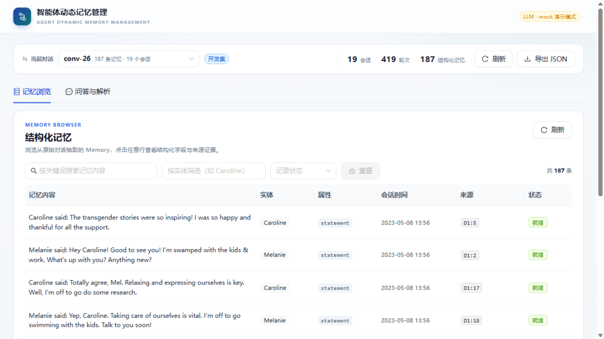

### 图 2 关键词筛选 `adoption`

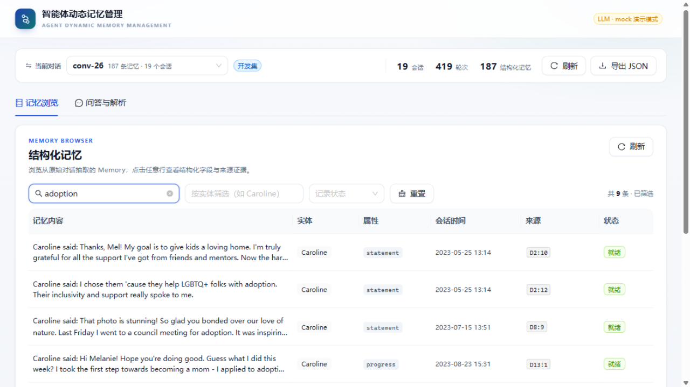

### 图 3 记忆详情：结构化字段

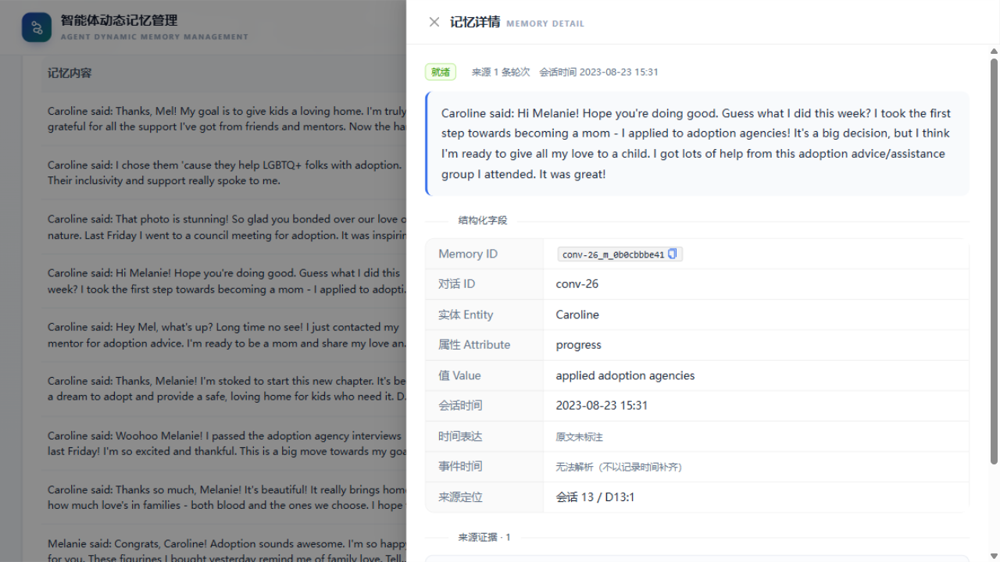

### 图 4 记忆详情：来源证据原文

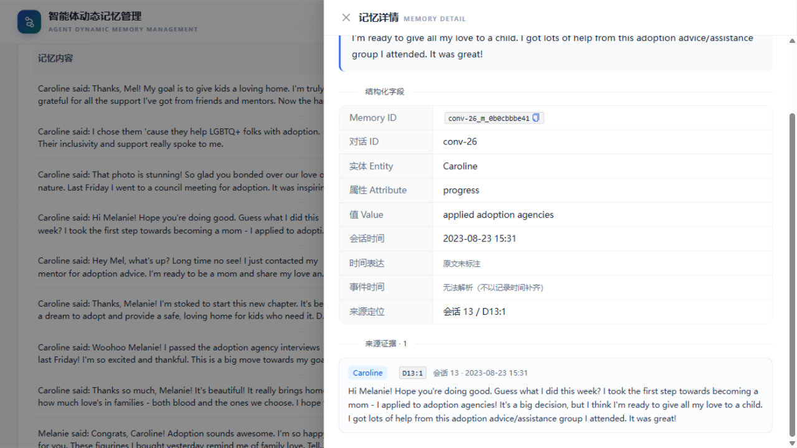

### 图 5 问答页初始状态与流水线说明

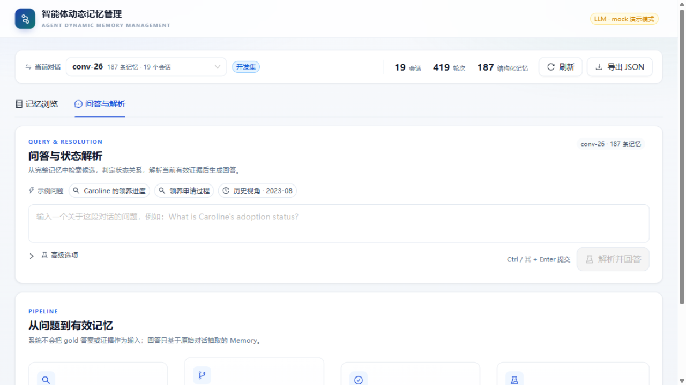

### 图 6 最终回答与引用证据

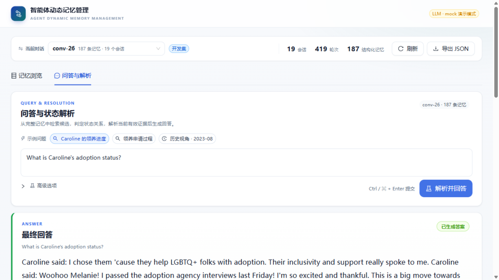

### 图 7 关系时间线：UPDATE 旧状态 → 新状态

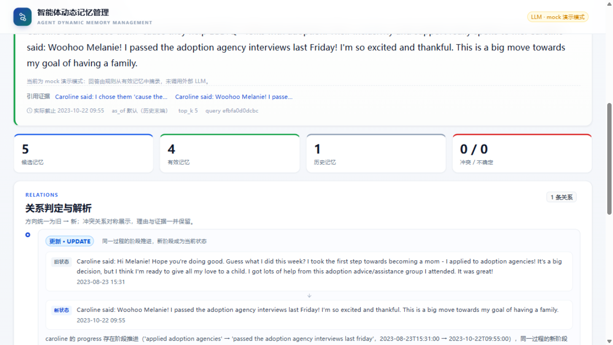

### 图 8 候选记忆与逐条有效性

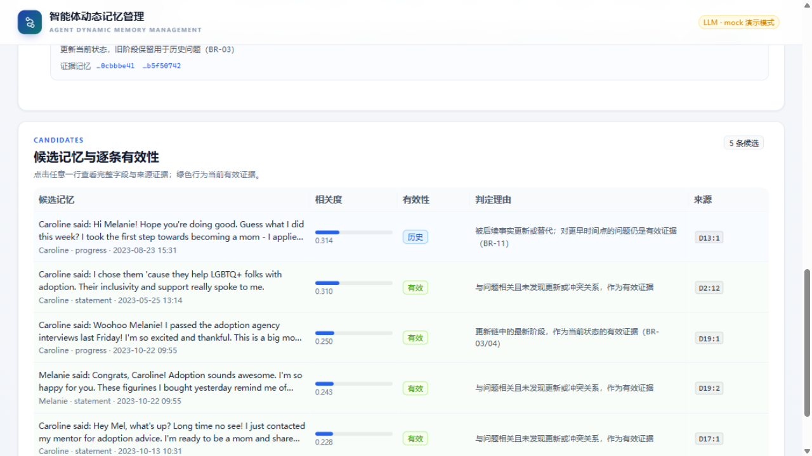

### 图 9 历史视角：`as_of=2023-08-01`

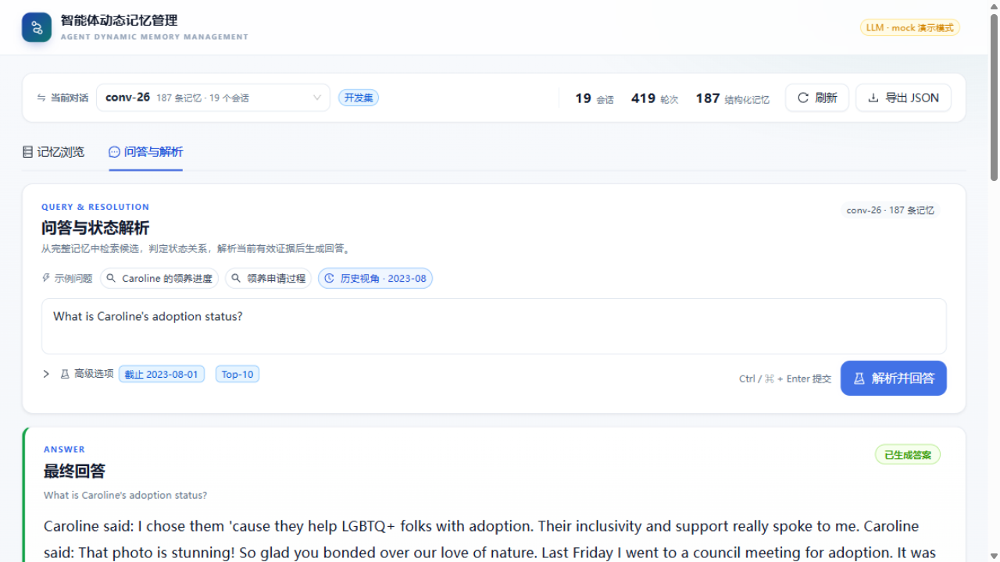

### 图 10 conv-30 对话切换与 Gina 查询

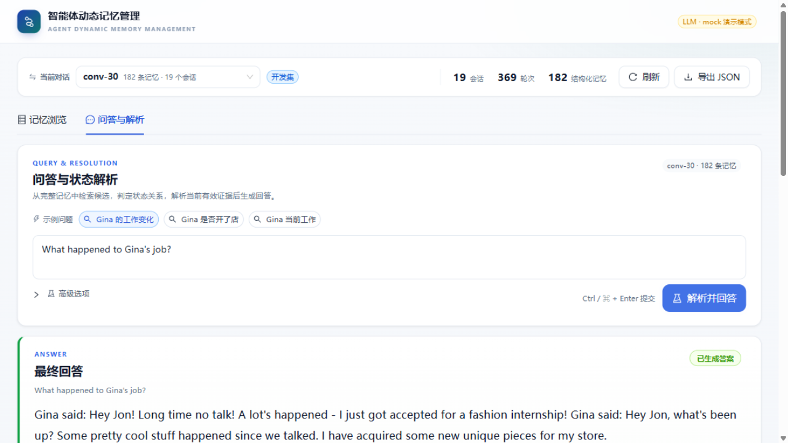

### 图 11 导出成功提示

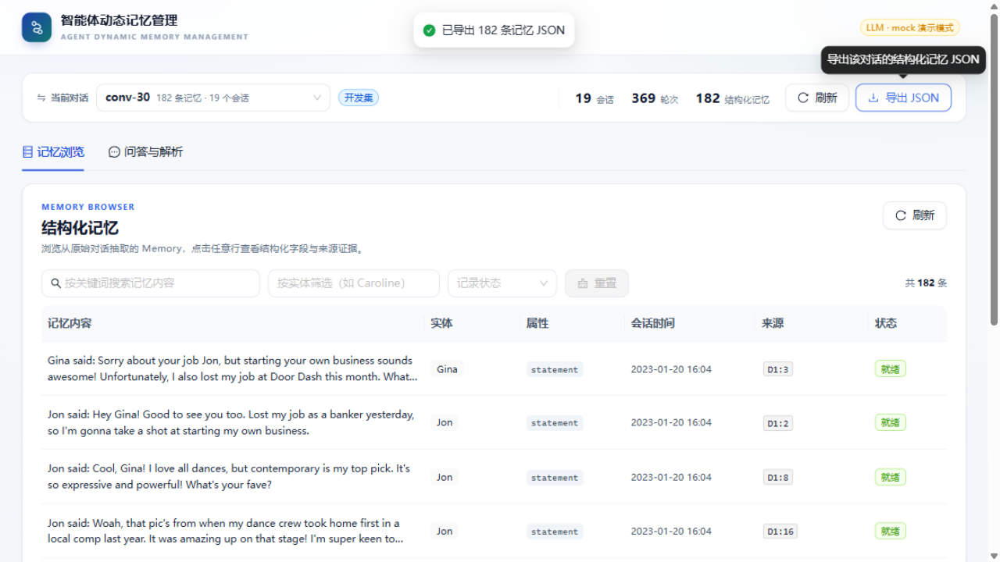

### 图 12 证据不足状态

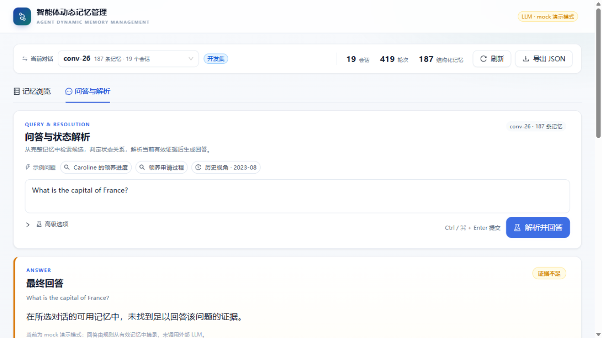

### 图 13 SUPERSEDE 关系

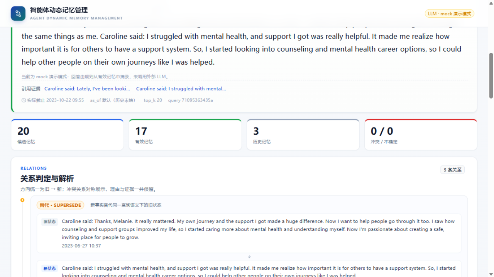

### 图 14 合成 CONFLICT 用例：答案状态与冲突说明

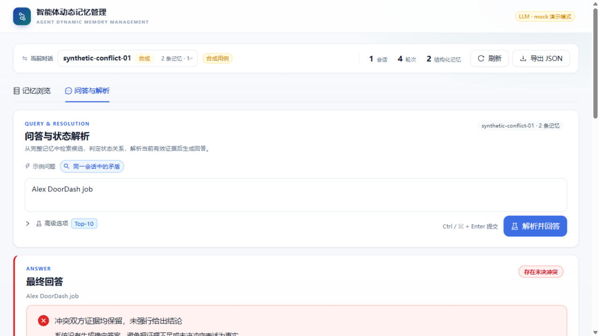

### 图 15 合成 CONFLICT 用例：关系时间线与冲突候选

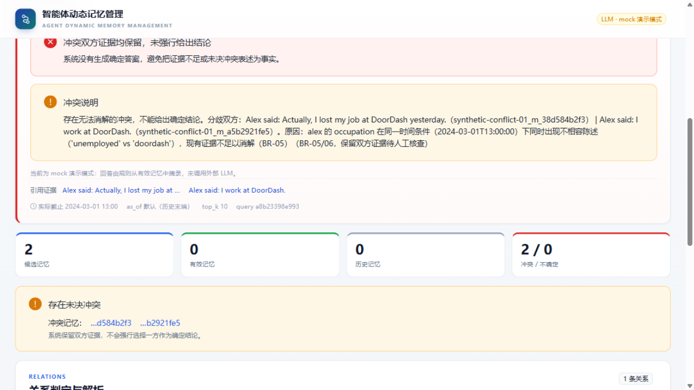

### 图 16 Gina 工作变化：干净 SUPERSEDE 答案

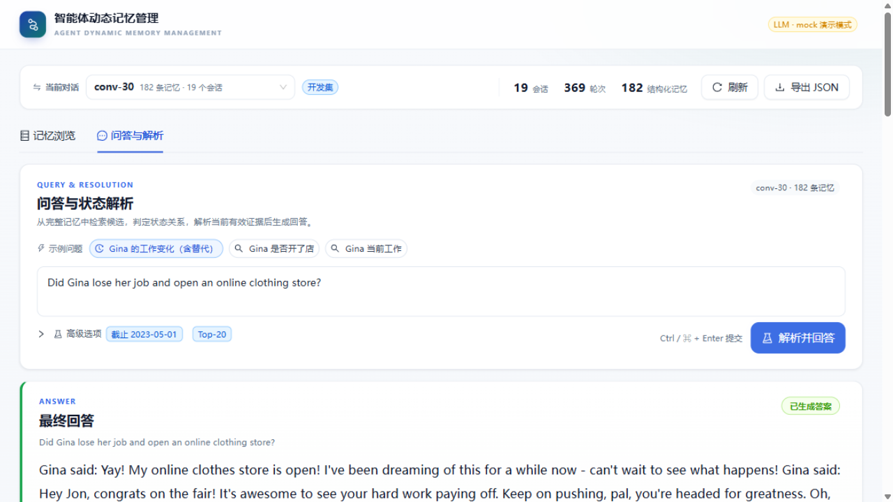

### 图 17 Gina 工作变化：旧状态 → 新状态

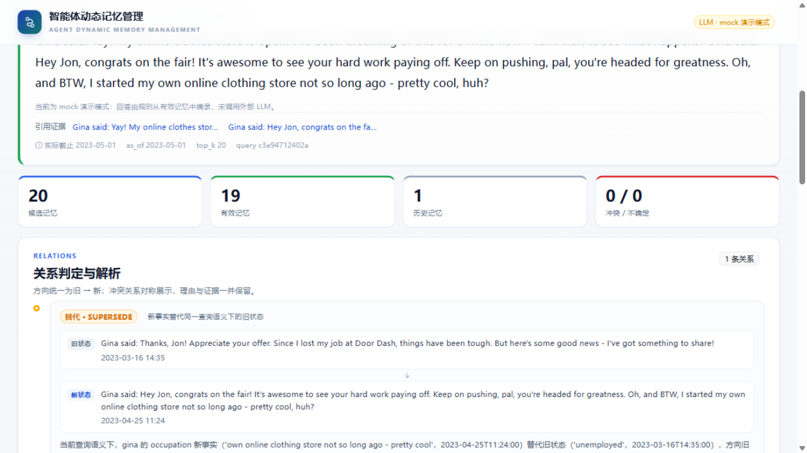

## 7. 限制与后续

1. 当前使用 `mock` provider。回答文本是规则从有效记忆摘录的英文原文；页面已提示 mock 模式。接入 DeepSeek Flash 后应重新跑 TC-05～TC-09。
2. 关系判定使用 rules 模式。UPDATE 和 SUPERSEDE 已在 conv-26/conv-30 现有数据上验证；CONFLICT 已用明确标记的合成用例 `synthetic-conflict-01` 验证。真实 conv-26/conv-30 中没有同会话同属性矛盾对，合成用例只证明规则和页面正确，不进入真实评测。
3. 批量评测（FR-13/AT-16）仍是 501 占位，正式 F1 / Recall@K / 状态准确率尚未计算。
4. 性能（NFR-06/07）与安全（AT-18）未测；M4 不宣称这些指标达标。
5. 开发数据仅使用 conv-26/conv-30 两段开发集；另有一个合成 CONFLICT 用例，明确标记为合成，不进入指标评测。
6. 本报告没有使用 QA 答案、gold 证据或事件摘要作为推理输入；证据回溯只读取原始对话轮次。
